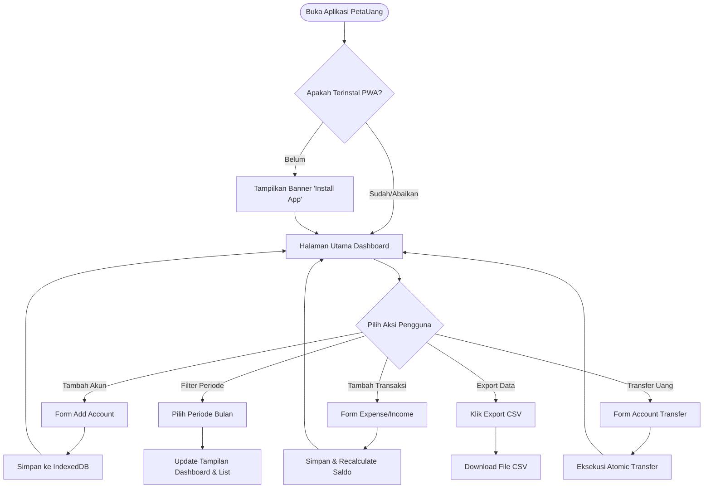
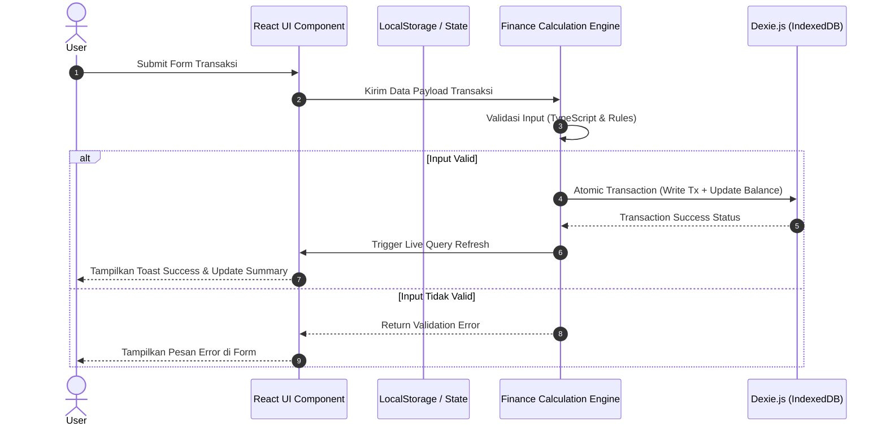
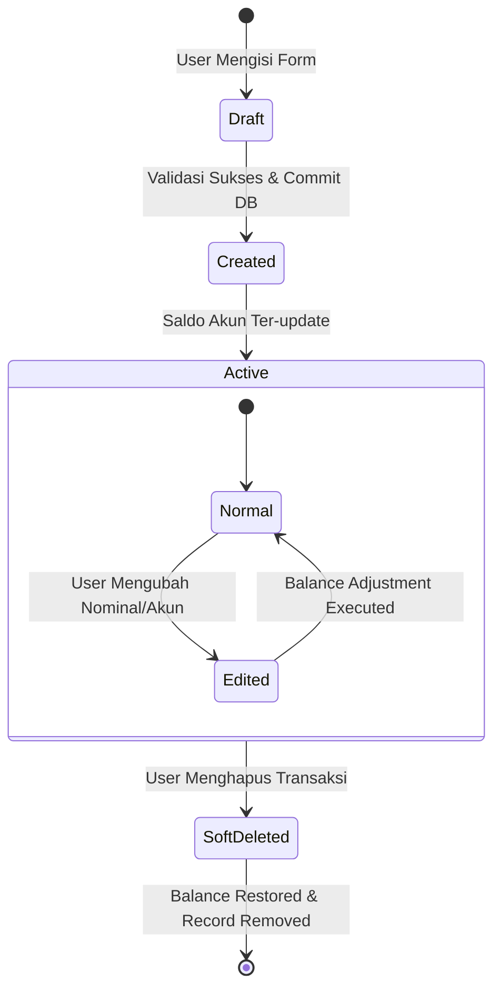
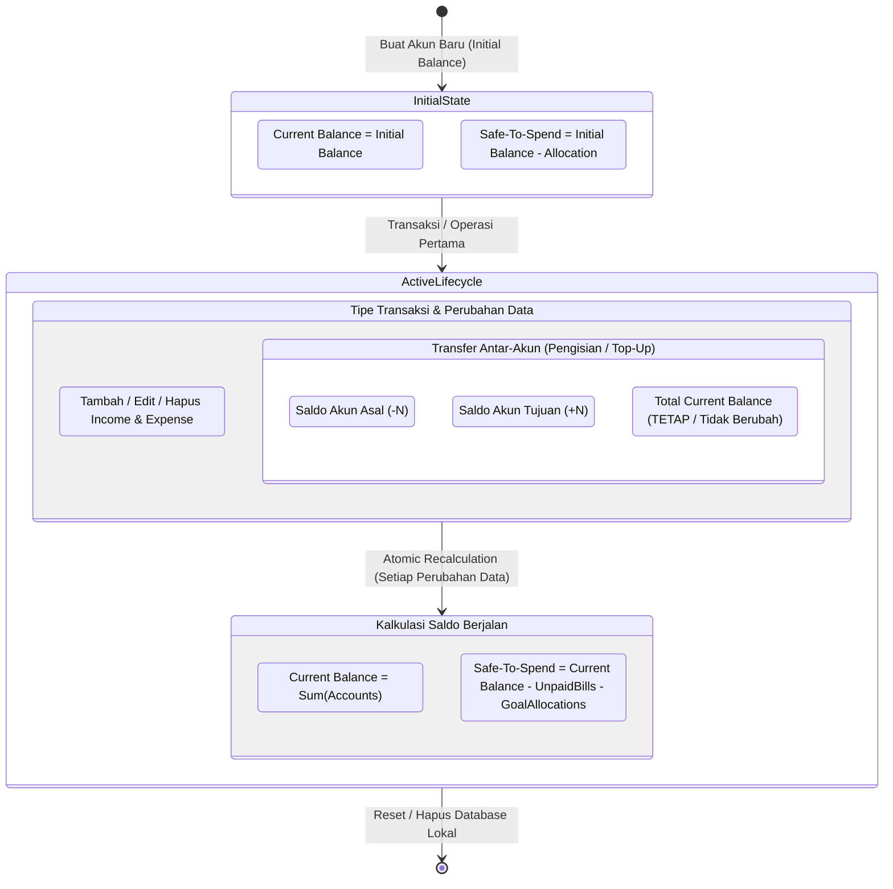
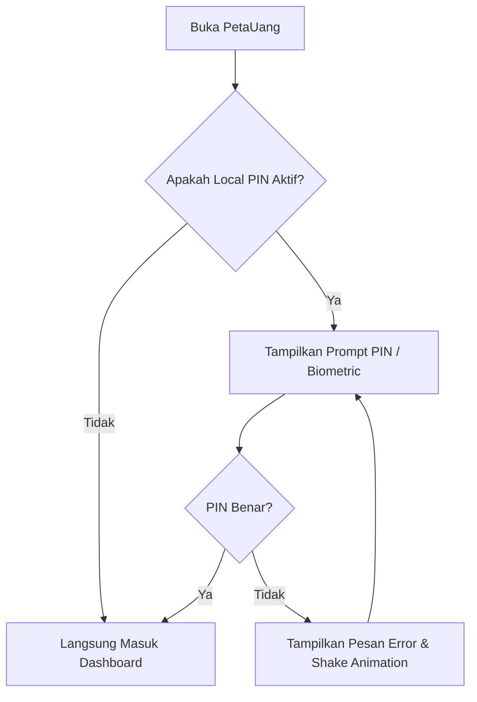
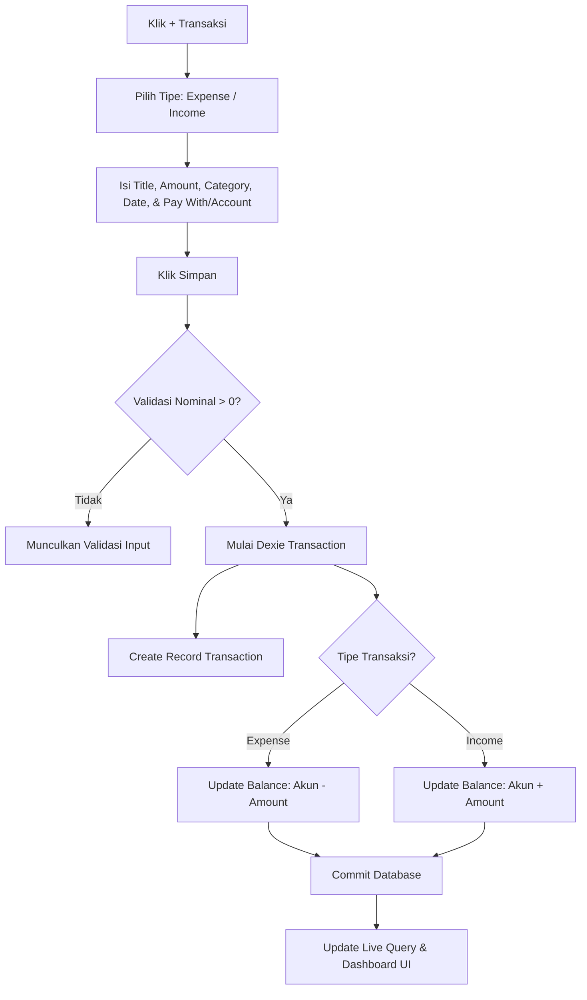
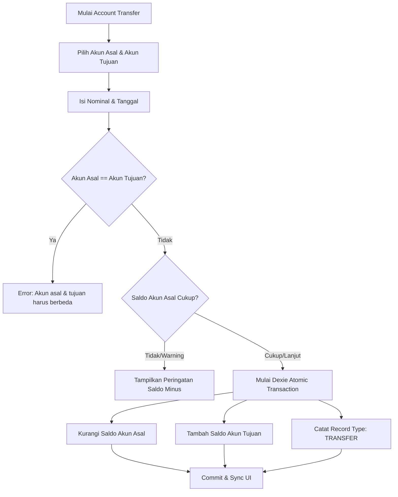
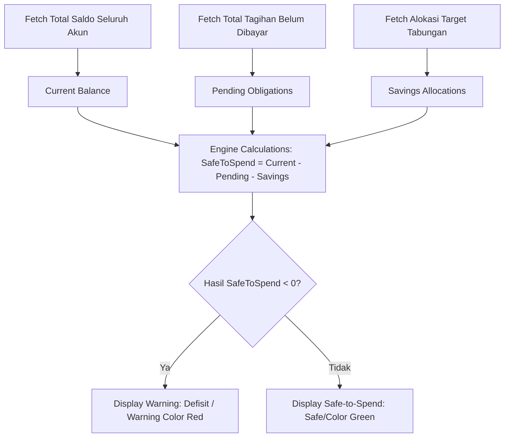
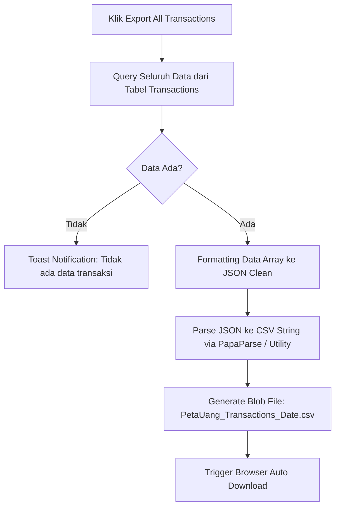
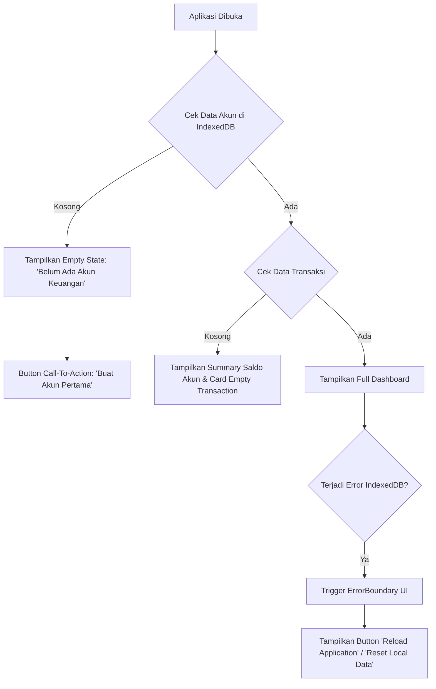

# 🔄 Application Flow Documentation (AFD) — PetaUang

Dokumen ini menjelaskan alur kerja aplikasi PetaUang yang mencakup perjalanan pengguna (*User Flow*), logika sistem internal (*System Flow*), serta perubahan status data (*State Flow*) menggunakan format diagram Mermaid.

---

## 1. User Flow (Perjalanan Pengguna Utama)

Alur umum pengguna dari membuka aplikasi PWA PetaUang hingga mengelola keuangan harian.

---

## 2. System Flow (Proses Internal Local-First)

Proses internal aplikasi dalam memproses data tanpa ketergantungan server (*Client-Side Engine*).

---

## 3. State Flow (Perubahan Status Objek Saldo & Transaksi)

### A. Lifecycle Status Transaksi

### B. Saldo Lifecycle (Current vs Safe-To-Spend)

---

## 4. Authentication & Registration Flow (Local Security Setup)

Karena PetaUang berarsitektur *Zero-Server / Local-First*, autentikasi bersifat **Local PIN Protection** (Opsional) untuk mengunci aplikasi di perangkat lokal.

---

## 5. Transaction Flow (Expense & Income)

Alur penambahan pengeluaran atau pemasukan beserta kalkulasi saldo atomik.

---

## 6. Transfer Flow (Account Transfer)

Alur pemindahan dana antar-akun tanpa memengaruhi total Income/Expense bulanan.

---

## 7. Budget Tracking & Safe-to-Spend Flow

Logika pemrosesan indikator "Saldo Sesungguhnya" (*Safe-to-Spend*).

---

## 8. Export All Transactions Flow

Alur ekspor seluruh data lokal ke format file CSV.

---

## 9. Error and Empty-State Flow

Penanganan tampilan saat data kosong (*Empty State*) atau terjadi kegagalan lokal.

