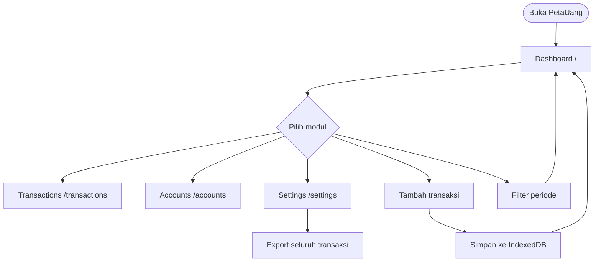
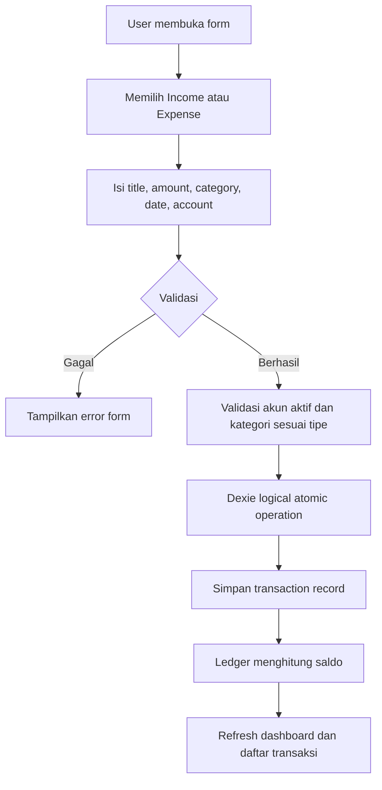
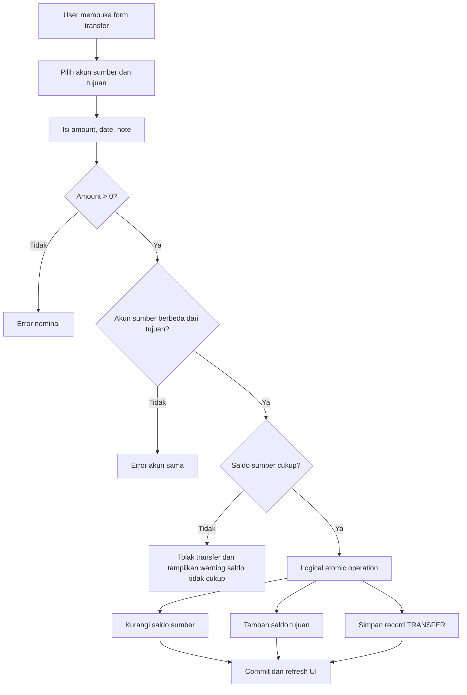
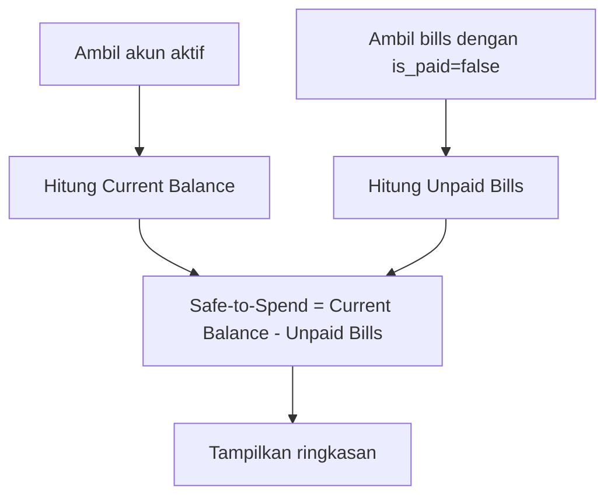

# Application Flow Documentation (AFD) — PetaUang

## 1. Prinsip Navigasi

Modul utama menggunakan route terpisah:

- `/` — Dashboard
- `/transactions` — Transactions
- `/accounts` — Accounts
- `/settings` — Settings

Tabs digunakan hanya sebagai navigasi sekunder di dalam modul, misalnya All, Income, dan Expense pada `/transactions`.

MVP tidak memiliki registrasi, login, autentikasi eksternal, PIN, atau pemulihan kredensial. Pengguna yang mengakses storage browser memiliki akses ke data lokal pada perangkat tersebut.

## 2. User Flow Utama

## 3. Flow Transaksi Income dan Expense

## 4. Flow Transfer

Transfer internal tidak dihitung sebagai income atau expense global dan tidak mengubah net worth keseluruhan.

## 5. Flow Dashboard

Goal Allocations tidak digunakan dalam kalkulasi MVP.

## 6. Flow Filter Periode

1. User memilih bulan.
2. Sistem memfilter transaksi berdasarkan `transaction_date`.
3. Sistem memperbarui daftar transaksi dan ringkasan income/expense periode tersebut.

## 7. Flow Export CSV

1. User membuka `/settings` atau kontrol export yang disediakan modul.
2. Sistem mengambil seluruh transaksi, akun, dan kategori lokal.
3. Sistem memetakan data ke schema canonical sembilan kolom.
4. Sistem menghasilkan file `PetaUang_All_Transactions_YYYY-MM-DD.csv`.
5. Browser memulai unduhan lokal.
6. Jika tidak ada data, sistem menampilkan empty-state; jika terjadi kegagalan, sistem menampilkan error-state.

## 8. Empty, Loading, dan Error State

- Tidak ada akun: tampilkan ajakan membuat akun pertama.
- Tidak ada transaksi pada periode: tampilkan ajakan mencatat transaksi.
- IndexedDB belum siap: tampilkan loading state.
- Operasi database gagal: tampilkan pesan error dan pertahankan data yang sudah tersimpan.
- Transfer ditolak karena saldo tidak cukup: tampilkan warning yang menjelaskan penyebabnya.

## 9. Status Implementasi Flow

Flow di atas adalah perilaku yang disetujui. Pada audit source code saat ini, route `/settings`, filter periode, pemeriksaan saldo transfer, dan sebagian error-state belum terbukti tersedia. Gap tersebut harus ditangani sebagai pekerjaan implementasi terpisah.
