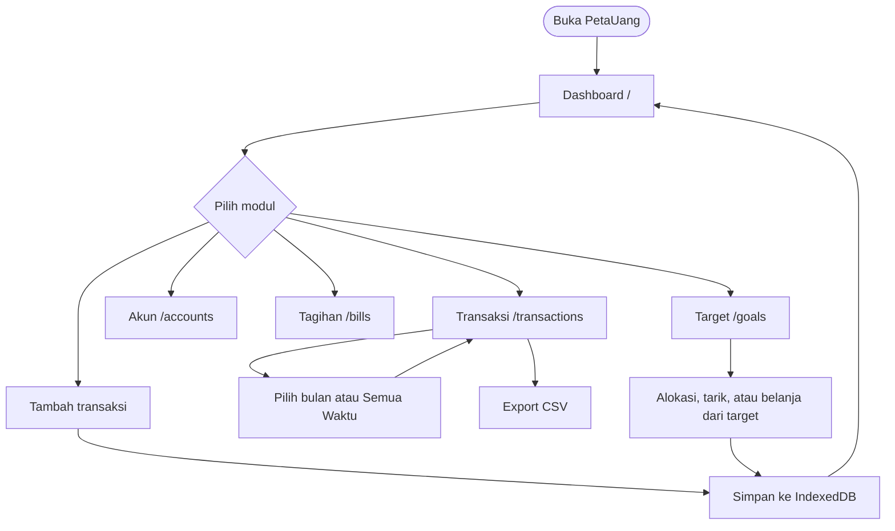
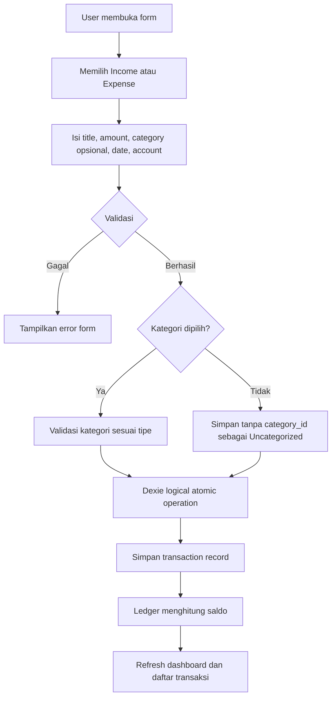
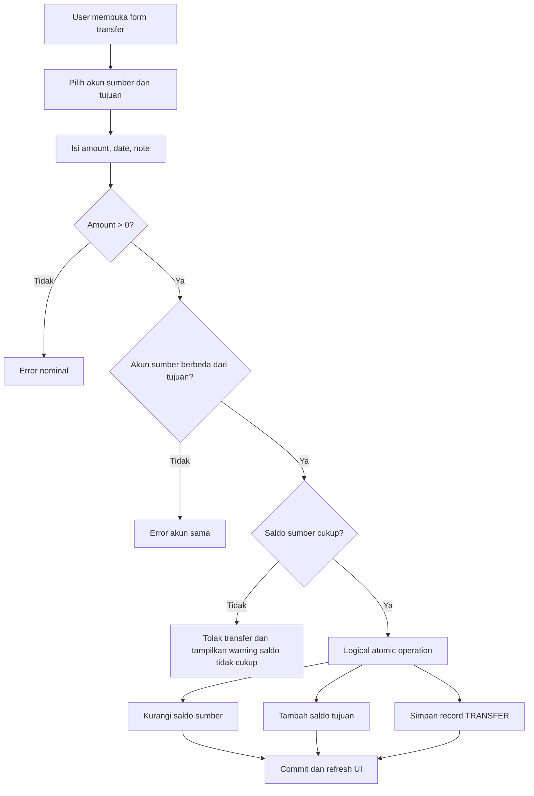
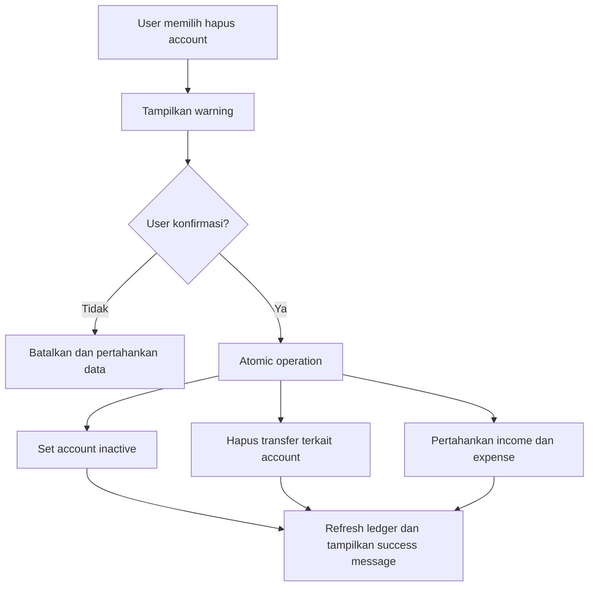
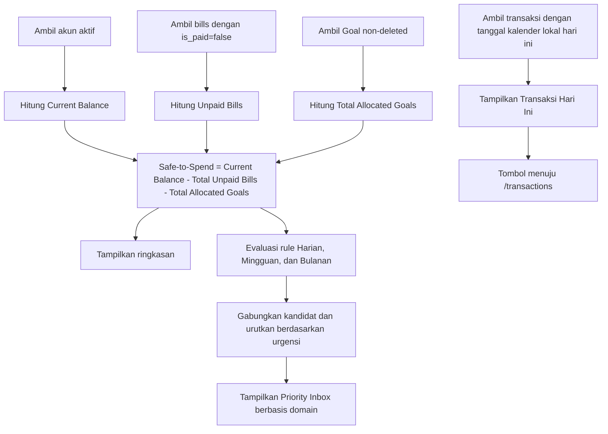
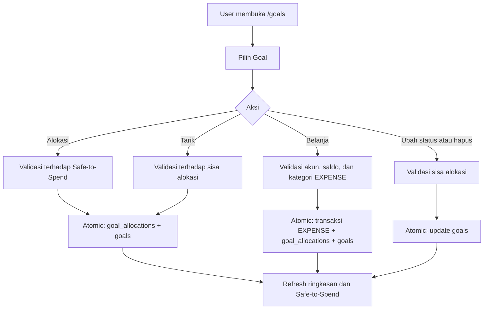

# Application Flow Documentation (AFD) — PetaUang

## 1. Prinsip Navigasi

Modul utama menggunakan route terpisah:

- `/` — Dashboard
- `/transactions` — Transaksi
- `/accounts` — Akun
- `/bills` — Tagihan
- `/goals` — Target tabungan dan alokasi dana

Tidak ada route `/settings`, termasuk sebagai alias kompatibilitas.

Label navigasi aktual adalah **Dashboard**, **Transaksi**, **Dompet** (`/accounts`), **Tagihan**, dan **Target** (`/goals`).

Tabs dan dialog digunakan hanya sebagai navigasi sekunder di dalam modul, misalnya pengelolaan kategori pada halaman transaksi.

MVP tidak memiliki registrasi, login, autentikasi eksternal, PIN, atau pemulihan kredensial. Pengguna yang mengakses storage browser memiliki akses ke data lokal pada perangkat tersebut.

## 2. User Flow Utama

Dashboard tidak memiliki filter periode. Halaman Transaksi memiliki filter periode yang independen.

## 3.1 Flow Bill Management

1. User membuka `/bills`.
2. User membuat bill dengan title, amount, dan due date.
3. Sistem memvalidasi title, integer amount, dan due date.
4. Bill baru disimpan dengan `is_paid=false`.
5. User menandai bill sebagai paid: sistem membuka dialog konfirmasi pembayaran untuk memilih akun pembayar, tanggal, dan kategori opsional.
6. Konfirmasi pembayaran secara atomic menandai `is_paid=true`, membuat transaksi `EXPENSE` baru di akun terkait, dan menautkan `transaction_id`.
7. User mengembalikan bill ke unpaid: sistem meminta konfirmasi, lalu secara atomic menandai `is_paid=false`, menghapus transaksi `EXPENSE` terkait, dan memulihkan saldo akun.
8. User dapat mengedit atau menghapus bill; jika bill berstatus paid, perubahan/penghapusan diperbarui secara atomic ke transaksi pengeluaran terkait.
9. Dashboard menghitung hanya bill unpaid ke dalam Safe-to-Spend.

## 3.2 Flow Category Management

1. User menekan tombol `Kelola Kategori` pada modul transaksi.
2. Sistem membuka modal overlay berisi form dan daftar kategori aktif.
3. User mengisi nama, memilih tipe transaksi, dan memilih ikon.
4. Sistem menyimpan kategori custom dengan ikon yang dipilih.
5. User dapat melihat, mengedit, atau menonaktifkan kategori default maupun custom; penonaktifan mempertahankan transaksi historis.

## 3.3 Flow Transaksi Income dan Expense

## 4. Flow Transfer

Transfer internal tidak dihitung sebagai income atau expense global dan tidak mengubah net worth keseluruhan.

## 5. Flow Penghapusan Account

Warning harus menjelaskan bahwa seluruh transfer yang melibatkan account tersebut akan dihapus, sedangkan income dan expense tetap tersedia.

## 6. Informasi Cash Flow

1. Dashboard selalu memakai transaksi bulan berjalan menurut kalender lokal dan tidak menyediakan kontrol periode.
2. Halaman Transaksi memakai bulan yang dipilih, atau seluruh transaksi saat mode **Semua Waktu** aktif.
3. Pada kedua tampilan, sistem menjumlahkan transaksi income sebagai Cash In dan expense sebagai Cash Out.
4. Transfer antar-account dikecualikan dari kedua total.
5. Kedua tampilan menampilkan Cash In, Cash Out, dan selisihnya sebagai Net Cash Flow.
6. Saat transaksi berubah, ringkasan dihitung ulang dari data lokal.

## 7. Flow Dashboard

Dashboard hanya menampilkan transaksi yang tanggal kalender lokalnya sama dengan hari ini. Transaksi kemarin dan transaksi bertanggal masa depan tidak ditampilkan. Jika tidak ada transaksi hari ini, Dashboard menampilkan empty state.

## 7.1 Flow Priority Inbox Insight

1. Sistem mengevaluasi rule Harian, Mingguan, dan Bulanan secara independen dari data lokal.
2. Setiap periode dapat menghasilkan nol atau lebih kandidat insight; kandidat utama tetap disimpan untuk kompatibilitas, sedangkan seluruh kandidat dipakai oleh Priority Inbox.
3. Sistem menggabungkan seluruh kandidat actionable dan mengurutkannya berdasarkan urgensi, lalu nominal dampak sebagai tie-breaker.
4. Dashboard menampilkan setiap kandidat sebagai kartu dengan identitas domain (`SALDO`, `TAGIHAN`, `PENGELUARAN`, `TARGET`, `DATA`), badge urgensi, dan metadata periode berukuran kecil.
5. Tidak ada batas jumlah kartu; insight dengan urgensi lebih rendah, termasuk W-2, tetap tampil meskipun W-1 juga terpicu.
6. CTA kartu membuka modul terkait: transaksi, tagihan, atau target.
7. Periode yang berstatus stabil atau belum memiliki data diringkas menjadi chip dan tidak dirender sebagai kartu penuh.
8. D-2 dan W-1 tetap menjadi dua kartu terpisah meskipun sama-sama memakai domain `TAGIHAN`.

## 8. Flow Filter Periode Halaman Transaksi

1. User membuka `/transactions`.
2. Halaman menampilkan bulan berjalan sebagai periode awal.
3. User dapat berpindah bulan atau mengaktifkan toggle **Semua Waktu**.
4. Saat toggle dinonaktifkan atau tombol **Bulan Ini** ditekan, halaman kembali ke bulan berjalan.
5. Sistem memfilter transaksi berdasarkan `transaction_date` dan memperbarui daftar serta ringkasan Income, Expense, dan Net Cash Flow.
6. Filter ini tidak memengaruhi Dashboard.

## 9. Flow Goals

Alokasi Goal mengurangi Safe-to-Spend tanpa mengubah saldo kas. Belanja dari Goal membuat transaksi `EXPENSE` riil sekaligus mengurangi alokasi. Goal dengan sisa alokasi tidak dapat dihapus atau diarsipkan.

## 10. Flow Account Adjustment

1. User membuka edit akun.
2. User mengubah nilai **Saldo Saat Ini**.
3. Sistem menghitung selisih terhadap saldo ledger saat ini.
4. Sistem membuat transaksi `Adjust Balance` bertipe `INCOME` bila saldo bertambah atau `EXPENSE` bila saldo berkurang.
5. `initial_balance` tidak berubah; penghapusan transaksi penyesuaian mengembalikan saldo ledger.

## 11. Flow Export CSV

1. User membuka `/transactions` dan menekan tombol **Export CSV**.
2. Sistem mengambil seluruh transaksi, akun, dan kategori lokal.
3. Sistem memetakan data ke schema canonical sembilan kolom.
4. Sistem menghasilkan file `PetaUang_All_Transactions_YYYY-MM-DD.csv`.
5. Browser memulai unduhan lokal.
6. Jika tidak ada data, sistem menampilkan empty-state; jika terjadi kegagalan, sistem menampilkan error-state.

## 12. Empty, Loading, dan Error State

- Tidak ada akun: tampilkan ajakan membuat akun pertama.
- Tidak ada transaksi pada periode: tampilkan ajakan mencatat transaksi.
- Tidak ada transaksi hari ini di Dashboard: tampilkan empty state khusus.
- Tidak ada insight actionable: tampilkan empty state “Tidak ada hal mendesak” dan ringkas periode stabil/menunggu data sebagai chip.
- Tidak ada Goal: tampilkan ajakan membuat target pertama.
- IndexedDB belum siap: tampilkan loading state.
- Operasi database gagal: tampilkan pesan error dan pertahankan data yang sudah tersimpan.
- Transfer ditolak karena saldo tidak cukup: tampilkan warning yang menjelaskan penyebabnya.
- Alokasi melebihi Safe-to-Spend atau penarikan melebihi sisa alokasi: tampilkan pesan validasi.

## 13. Status Implementasi Flow

Flow di atas mencerminkan perilaku yang disetujui dan tersedia di source. Route aktif adalah `/`, `/transactions`, `/accounts`, `/bills`, dan `/goals`; tidak ada alias `/settings`. Automated test mencakup sebagian perhitungan dan service. Acceptance test manual berbasis browser untuk alur UI, PWA, dan responsive behavior masih diperlukan.
