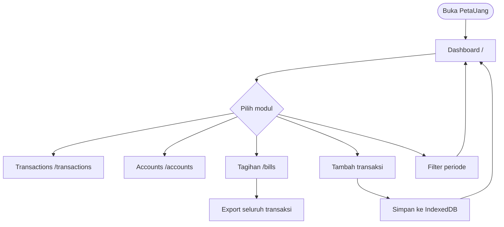
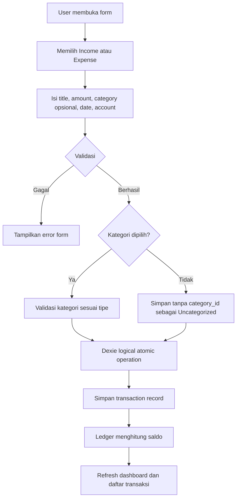
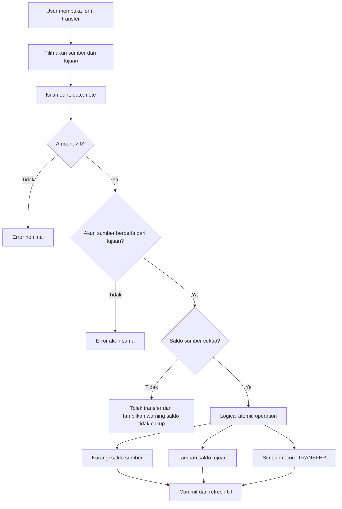
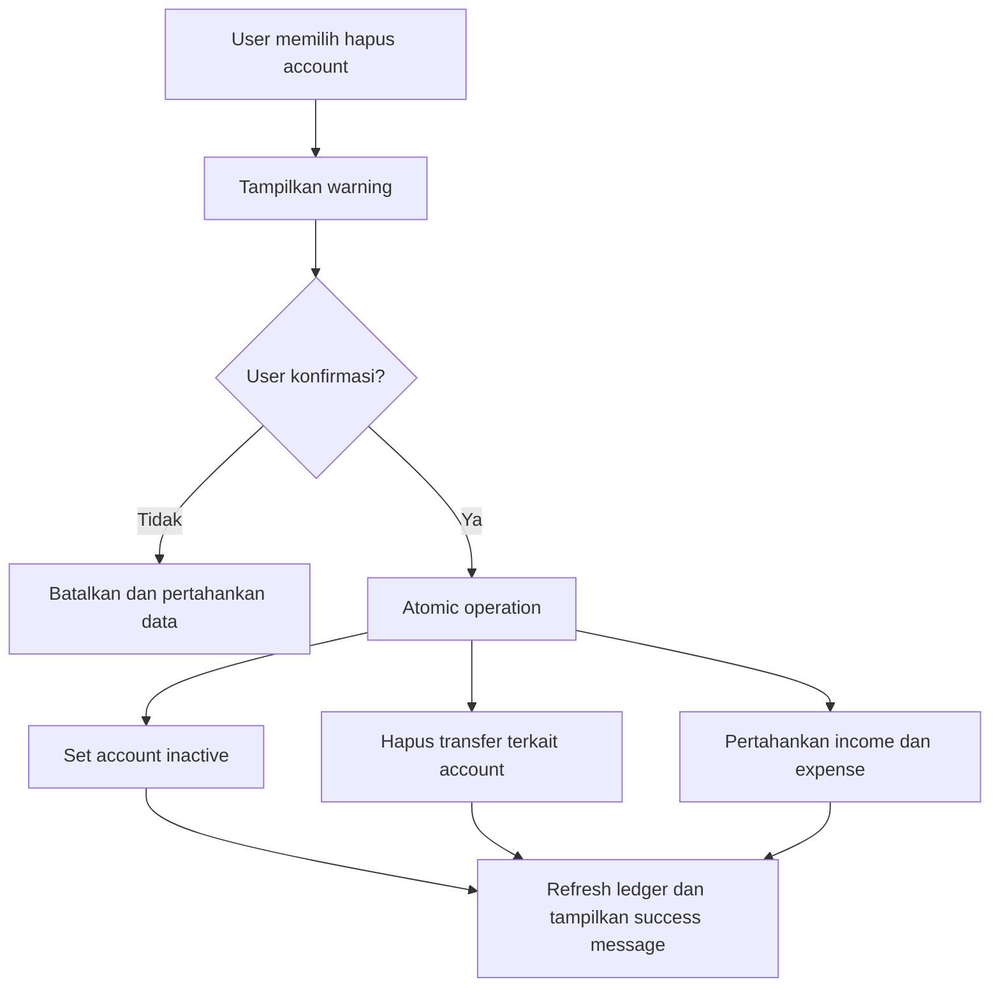
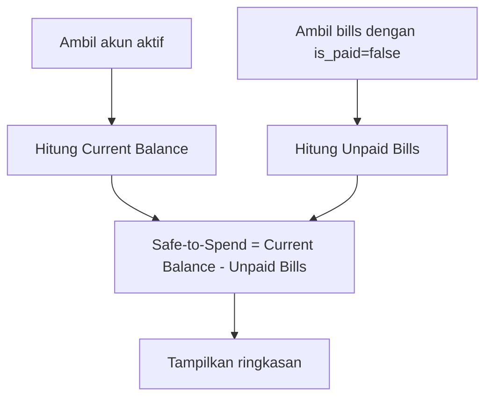

# Application Flow Documentation (AFD) — PetaUang

## 1. Prinsip Navigasi

Modul utama menggunakan route terpisah:

- `/` — Dashboard
- `/transactions` — Transactions
- `/accounts` — Accounts
- `/bills` — Tagihan

Tabs digunakan hanya sebagai navigasi sekunder di dalam modul, misalnya All, Income, dan Expense pada `/transactions`.

MVP tidak memiliki registrasi, login, autentikasi eksternal, PIN, atau pemulihan kredensial. Pengguna yang mengakses storage browser memiliki akses ke data lokal pada perangkat tersebut.

## 2. User Flow Utama

## 3.1 Flow Bill Management

1. User membuka modul tagihan pada route atau kontrol yang disediakan.
2. User membuat bill dengan title, amount, dan due date.
3. Sistem memvalidasi title, integer amount, dan due date.
4. Bill baru disimpan dengan `is_paid=false`.
5. User menandai bill sebagai paid: sistem membuka dialog konfirmasi pembayaran untuk memilih akun pembayar, tanggal, dan kategori opsional.
6. Konfirmasi pembayaran secara atomic menandai `is_paid=true`, membuat transaksi `EXPENSE` baru di akun terkait, dan menautkan `transaction_id`.
7. User mengembalikan bill ke unpaid: sistem meminta konfirmasi, lalu secara atomic menandai `is_paid=false`, menghapus transaksi `EXPENSE` terkait, dan memulihkan saldo akun.
8. User dapat mengedit atau menghapus bill; jika bill berstatus paid, perubahan/penghapusan diperbarui secara atomic ke transaksi pengeluaran terkait.
9. Dashboard menghitung hanya bill unpaid ke dalam Safe-to-Spend.

## 3.2 Flow Category Management

1. User menekan tombol `Kelola Kategori` pada modul transaksi.
2. Sistem membuka modal overlay berisi form dan daftar kategori aktif.
3. User mengisi nama, memilih tipe transaksi, dan memilih ikon.
4. Sistem menyimpan kategori custom dengan ikon yang dipilih.
5. User dapat melihat, mengedit, atau menonaktifkan kategori default maupun custom; penonaktifan mempertahankan transaksi historis.

## 3. Flow Transaksi Income dan Expense

## 4. Flow Transfer

Transfer internal tidak dihitung sebagai income atau expense global dan tidak mengubah net worth keseluruhan.

## 5. Flow Penghapusan Account

Warning harus menjelaskan bahwa seluruh transfer yang melibatkan account tersebut akan dihapus, sedangkan income dan expense tetap tersedia.

## 6. Informasi Cash Flow Dashboard

1. Dashboard memakai periode bulan yang sedang dipilih.
2. Sistem menjumlahkan transaksi income sebagai Cash In dan expense sebagai Cash Out pada periode tersebut.
3. Sistem mengecualikan transfer antar-account dari kedua total.
4. Dashboard menampilkan Cash In, Cash Out, dan selisihnya sebagai Net Cash Flow.
5. Saat periode atau transaksi berubah, ringkasan dihitung ulang dari data lokal.

## 6. Flow Dashboard

Goal Allocations tidak digunakan dalam kalkulasi MVP.

## 7. Flow Filter Periode

1. User memilih bulan.
2. Sistem memfilter transaksi berdasarkan `transaction_date`.
3. Sistem memperbarui daftar transaksi dan ringkasan income/expense periode tersebut.

## 8. Flow Export CSV

1. User membuka `/bills` atau kontrol export yang disediakan modul.
2. Sistem mengambil seluruh transaksi, akun, dan kategori lokal.
3. Sistem memetakan data ke schema canonical sembilan kolom.
4. Sistem menghasilkan file `PetaUang_All_Transactions_YYYY-MM-DD.csv`.
5. Browser memulai unduhan lokal.
6. Jika tidak ada data, sistem menampilkan empty-state; jika terjadi kegagalan, sistem menampilkan error-state.

## 9. Empty, Loading, dan Error State

- Tidak ada akun: tampilkan ajakan membuat akun pertama.
- Tidak ada transaksi pada periode: tampilkan ajakan mencatat transaksi.
- IndexedDB belum siap: tampilkan loading state.
- Operasi database gagal: tampilkan pesan error dan pertahankan data yang sudah tersimpan.
- Transfer ditolak karena saldo tidak cukup: tampilkan warning yang menjelaskan penyebabnya.

## 10. Status Implementasi Flow

Flow di atas adalah perilaku yang disetujui. Source code memiliki route `/bills` untuk Bill Management; `/settings` dipertahankan sebagai alias kompatibilitas. Acceptance test manual, filter periode, dan sebagian error-state masih perlu diverifikasi.
