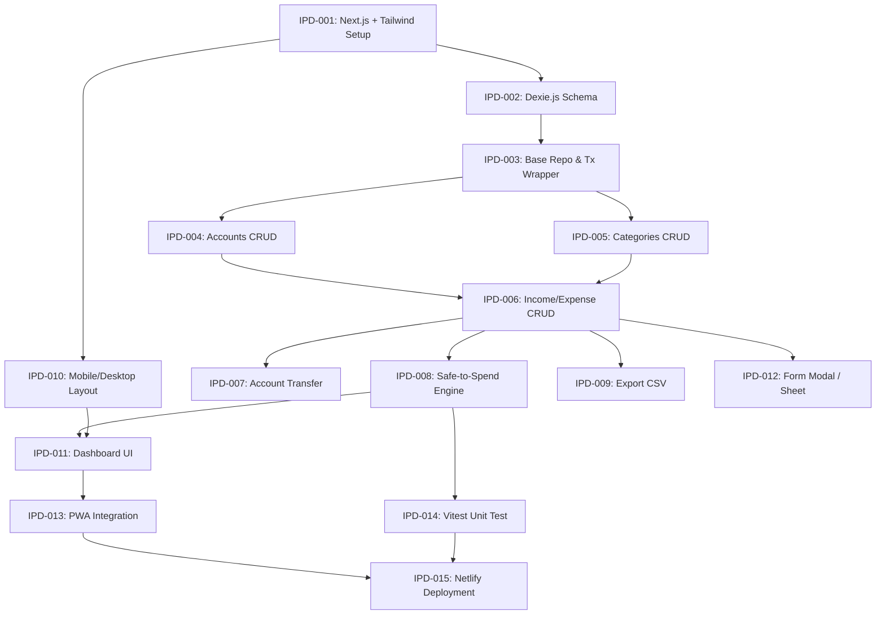

# 🚀 Implementation Plan Document (IPD) — PetaUang

## 1. Implementation Overview
* **Nama Proyek:** PetaUang
* **Arsitektur:** Local-First Progressive Web App (PWA) with Client-Side Database
* **Tech Stack:** Next.js (App Router), TypeScript, Tailwind CSS, Dexie.js (IndexedDB wrapper), Lucide React
* **Target Hosting:** Netlify (Static HTML Export / Jamstack)
* **Tujuan IPD:** Menyajikan daftar pekerjaan yang terukur, terurut berdasarkan ketergantungan teknis, dan siap dieksekusi secara bertahap (*step-by-step*) oleh pengembang maupun AI coding agent.

---

## 2. Development Phases

```
┌─────────────────────────────────────────────────────────────────────────┐
│                          TAHAPAN PENGERJAAN                             │
├──────────────┬──────────────┬──────────────┬──────────────┬─────────────┤
│ Fase 1       │ Fase 2       │ Fase 3       │ Fase 4       │ Fase 5      │
│ Project      │ Core Data    │ Business     │ UI/UX & PWA  │ Polish &    │
│ Foundation   │ & Storage    │ Logic & CRUD │ Refinement   │ Deployment  │
└──────────────┴──────────────┴──────────────┴──────────────┴─────────────┘
```

* **Fase 1: Project Foundation & Environment Setup** (Inisialisasi repo, Tailwind, TypeScript, & PWA manifest)
* **Fase 2: Core Data Engine & Storage** (Setup Dexie.js schema, repositori data, & transactional helper)
* **Fase 3: Business Logic & Feature CRUD** (Akun, Transaksi, Transfer, Safe-to-Spend, & Export CSV)
* **Fase 4: UI/UX Component & PWA Integration** (Mobile-first layout, Bottom Sheet, Toast, & Service Worker)
* **Fase 5: Polish, Testing, & Deployment** (Unit test logika finansial, build export, & deployment Netlify)

---

## 3. Progress Tracking Matrix

| ID | Task Description | Priority | Phase | Status |
| :--- | :--- | :--- | :--- | :--- |
| **IPD-001** | Inisialisasi Project Next.js + TypeScript + Tailwind | High | Fase 1 | Todo |
| **IPD-002** | Setup Dexie.js Database Schema & Connection | High | Fase 2 | Todo |
| **IPD-003** | Implementasi Base Repository & Transaction Wrapper | High | Fase 2 | Todo |
| **IPD-004** | Modul Accounts CRUD & Initial Balance | High | Fase 3 | Todo |
| **IPD-005** | Modul Categories (Expense/Income Default & Custom) | High | Fase 3 | Todo |
| **IPD-006** | Modul Income & Expense CRUD (Atomic Balance Recalculation)| High | Fase 3 | Todo |
| **IPD-007** | Modul Account Transfer (Atomic Zero-Sum Execution) | High | Fase 3 | Todo |
| **IPD-008** | Engine Calculation: Safe-to-Spend & Financial Health | High | Fase 3 | Todo |
| **IPD-009** | Modul Export All Transactions (CSV Generator) | Medium | Fase 3 | Todo |
| **IPD-010** | Layout Mobile-First & Navigation (Bottom Bar + Desktop Sidebar) | Medium | Fase 4 | Todo |
| **IPD-011** | Dashboard UI Components (Balance Hero, Cards, Month Filter) | Medium | Fase 4 | Todo |
| **IPD-012** | Form Modal & Bottom Sheet (Touch-Friendly Input) | Medium | Fase 4 | Todo |
| **IPD-013** | Integrasi PWA & Offline Support (Service Worker) | Medium | Fase 4 | Todo |
| **IPD-014** | Unit Testing Finance Logic (Vitest) | High | Fase 5 | Todo |
| **IPD-015** | Build Export & Netlify Deployment Setup | High | Fase 5 | Todo |

---

## 4. Task Breakdown & Detailed Specifications

### IPD-001: Inisialisasi Project Next.js + TypeScript + Tailwind
* **Objective:** Menyiapkan repositori dasar proyek Next.js App Router dengan TypeScript, Tailwind CSS, dan Lucide React.
* **Related Requirement ID:** TRD Section 2, DBD Section 6 & 7.
* **Technical Reference:** Next.js 14+ App Router, Tailwind CSS v3/v4.
* **Dependencies:** None.
* **Acceptance Criteria:**
  * Proyek berhasil di-build tanpa error TypeScript/ESLint.
  * Tailwind CSS terkonfigurasi dengan font Inter/Plus Jakarta Sans & JetBrains Mono.
  * Struktur folder `src/` mengikuti arsitektur modular yang disepakati.
* **Test Cases:**
  * Jalankan `npm run dev` dan pastikan localhost:3000 dapat diakses.
  * Jalankan `npm run build` dan pastikan proses kompilasi sukses.
* **Completion Status:** Todo

---

### IPD-002: Setup Dexie.js Database Schema & Connection
* **Objective:** Mengonfigurasikan koneksi IndexedDB menggunakan Dexie.js sesuai spesifikasi BSD.
* **Related Requirement ID:** BSD Section 2 (Tables Specification), TRD Section 2.
* **Technical Reference:** Dexie.js `Dexie` class & schema definition.
* **Dependencies:** IPD-001.
* **Acceptance Criteria:**
  * File `src/lib/db/schema.ts` mendefinisikan tabel: `accounts`, `categories`, `transactions`, `budgets`, `bills`.
  * Semua atribut kunci (`id`, `account_id`, `created_at`, dll) ter-index dengan benar.
  * Tersedia data bawaan (*seed categories*) saat database pertama kali dibuka.
* **Test Cases:**
  * Buka DevTools Browser > Application > IndexedDB, verifikasi skema database `PetaUangDB` berhasil terbuat.
* **Completion Status:** Todo

---

### IPD-003: Implementasi Base Repository & Transaction Wrapper
* **Objective:** Membuat abstraksi fungsi *read/write* dan *wrapper* transaksi database atomic.
* **Related Requirement ID:** BSD Section 3 (Atomic Balance Recalculation), TRD Section 6.
* **Technical Reference:** `db.transaction('rw', ...)` Dexie.js API.
* **Dependencies:** IPD-002.
* **Acceptance Criteria:**
  * Fungsi `runInTransaction()` dapat mengeksekusi multiple perintah secara *atomic*.
  * Jika terjadi error di tengah proses, seluruh perubahan dibatalkan (*rollback*).
* **Test Cases:**
  * Simulasikan error buatan di langkah ke-2 transaksi, verifikasi data di langkah ke-1 tidak tersimpan.
* **Completion Status:** Todo

---

### IPD-004: Modul Accounts CRUD & Initial Balance
* **Objective:** Mengembangkan service dan repositori untuk mengelola akun keuangan (Kas, Bank, E-Wallet).
* **Related Requirement ID:** PRD FR-01, BSD Table `accounts`.
* **Technical Reference:** `src/lib/services/accountService.ts`.
* **Dependencies:** IPD-003.
* **Acceptance Criteria:**
  * Pengguna dapat membuat akun baru dengan mengisi Nama, Tipe, dan Saldo Awal (`initial_balance`).
  * Nilai `initial_balance` disimpan sebagai Integer positif (satuan Rupiah utuh).
  * Akun dapat diedit nama/tipenya dan didukung *soft-delete* (`is_active = false`).
* **Test Cases:**
  * Input akun "Bank BCA" dengan saldo awal 1.000.000. Verifikasi record tersimpan di IndexedDB.
* **Completion Status:** Todo

---

### IPD-005: Modul Categories (Expense/Income Default & Custom)
* **Objective:** Mengelola kategori transaksi beserta ikon dan tipenya.
* **Related Requirement ID:** PRD FR-02/03, BSD Table `categories`.
* **Technical Reference:** `src/lib/services/categoryService.ts`.
* **Dependencies:** IPD-003.
* **Acceptance Criteria:**
  * Menyediakan kategori default (Makanan, Transportasi, Gaji, dll).
  * Pengguna dapat menambahkan kategori kustom baru.
  * Setiap kategori terikat tegas pada tipe `INCOME` atau `EXPENSE`.
* **Test Cases:**
  * Ambil daftar kategori `EXPENSE`, pastikan kategori bertipe `INCOME` tidak muncul.
* **Completion Status:** Todo

---

### IPD-006: Modul Income & Expense CRUD (Atomic Balance Recalculation)
* **Objective:** Membuat fungsi tambah, edit, dan hapus transaksi pemasukan dan pengeluaran.
* **Related Requirement ID:** PRD FR-02 & FR-03, BSD Business Rules 1-5.
* **Technical Reference:** `src/lib/services/transactionService.ts`.
* **Dependencies:** IPD-004, IPD-005.
* **Acceptance Criteria:**
  * Form input menerima: *Title*, *Category*, *Created On*, *Amount*, dan *Pay With / Deposit To*.
  * `amount` wajib berupa Integer positif (`> 0`).
  * Aksi Tambah/Edit/Hapus transaksi memicu hitung ulang saldo akun terkait secara *atomic*.
* **Test Cases:**
  * Tambah Expense 50.000 pada akun dengan saldo 200.000. Saldo akun harus menjadi 150.000.
  * Edit Expense tersebut menjadi 30.000. Saldo akun harus menyesuaikan otomatis menjadi 170.000.
  * Hapus Expense tersebut. Saldo akun harus kembali ke 200.000.
* **Completion Status:** Todo

---

### IPD-007: Modul Account Transfer (Atomic Zero-Sum Execution)
* **Objective:** Mengimplementasikan fungsi transfer antar-akun pribadi (pemindahan dana).
* **Related Requirement ID:** PRD FR-04, AFD Transfer Flow.
* **Technical Reference:** `src/lib/services/transferService.ts`.
* **Dependencies:** IPD-006.
* **Acceptance Criteria:**
  * Menerima input: Akun Asal (*Source*), Akun Tujuan (*Destination*), Nominal, Tanggal, Catatan.
  * Akun Asal dan Akun Tujuan tidak boleh sama (`account_id != destination_account_id`).
  * Saldo Akun Asal berkurang $N$, Saldo Akun Tujuan bertambah $N$. Total saldo global tetap (nol dampak pengeluaran/pemasukan bersih).
* **Test Cases:**
  * Transfer 100.000 dari Bank ke E-Wallet. Cek saldo Bank (-100rb), E-Wallet (+100rb), Total Saldo Global (Tidak Berubah).
* **Completion Status:** Todo

---

### IPD-008: Engine Calculation: Safe-to-Spend & Financial Health
* **Objective:** Membuat logika kalkulasi saldo ganda untuk Dashboard.
* **Related Requirement ID:** PRD FR-05, BSD Section 5.
* **Technical Reference:** `src/lib/finance/calculator.ts`.
* **Dependencies:** IPD-006, IPD-007.
* **Acceptance Criteria:**
  * **Current Balance:** Total penjumlahan seluruh saldo akun aktif (`is_active = true`).
  * **Safe-to-Spend:** $\text{Current Balance} - \text{Unpaid Bills} - \text{Goal Allocations}$.
  * Kalkulasi berjalan instan (< 10ms) menggunakan data lokal.
* **Test Cases:**
  * Set Total Saldo 2.000.000, Tagihan Belum Dibayar 500.000. Nilai Safe-to-Spend harus tepat 1.500.000.
* **Completion Status:** Todo

---

### IPD-009: Modul Export All Transactions (CSV Generator)
* **Objective:** Membuat fitur ekspor seluruh basis data transaksi ke file `.csv` yang dapat diunduh.
* **Related Requirement ID:** PRD FR-07, TRD Section 5.
* **Technical Reference:** `src/lib/utils/csvExporter.ts`.
* **Dependencies:** IPD-006.
* **Acceptance Criteria:**
  * Mengonversi seluruh baris transaksi menjadi string CSV dengan header: `ID, Date, Type, Title, Category, Account, Amount, Note`.
  * Format penamaan file: `PetaUang_Export_YYYY-MM-DD.csv`.
  * Dapat diunduh langsung di browser (client-side Blob download).
* **Test Cases:**
  * Klik tombol export, buka file `.csv` di Excel/Spreadsheet, pastikan baris data dan nominal sesuai.
* **Completion Status:** Todo

---

### IPD-010: Layout Mobile-First & Navigation (Bottom Bar + Desktop Sidebar)
* **Objective:** Mengembangkan kerangka layout UI responsif sesuai panduan DBD.
* **Related Requirement ID:** DBD Section 10 & 11, TRD Section 5.
* **Technical Reference:** `src/components/layout/AppLayout.tsx`.
* **Dependencies:** IPD-001.
* **Acceptance Criteria:**
  * Tampilan Mobile (< 640px): Bottom Navigation sticky (`h-16`) dengan area sentuh ibu jari.
  * Tampilan Desktop (> 1024px): Sidebar navigasi kiri (`w-64`) dan konten rata tengah (`max-w-6xl`).
* **Test Cases:**
  * Uji responsif pada Chrome DevTools mode iPhone (Mobile) dan Monitor (Desktop).
* **Completion Status:** Todo

---

### IPD-011: Dashboard UI Components (Balance Hero, Cards, Month Filter)
* **Objective:** Membangun antarmuka Dashboard utama untuk menampilkan statistik keuangan.
* **Related Requirement ID:** PRD FR-05 & FR-06, DBD Section 6 & 7.
* **Technical Reference:** `src/app/page.tsx`, `src/components/dashboard/`.
* **Dependencies:** IPD-008, IPD-010.
* **Acceptance Criteria:**
  * Menampilkan Angka Hero *Safe-to-Spend* (Font Mono, ukuran besar).
  * Kartu *Current Balance*, Income Bulanan, & Expense Bulanan.
  * Dropdown/Picker Filter Periode Bulan untuk memfilter grafik/tabel transaksi.
* **Test Cases:**
  * Ubah filter bulan ke "September 2026", pastikan statistik dan riwayat transaksi memperbarui datanya.
* **Completion Status:** Todo

---

### IPD-012: Form Modal & Bottom Sheet (Touch-Friendly Input)
* **Objective:** Membangun modal input transaksi yang fleksibel (Bottom Sheet di Mobile, Modal Dialog di Desktop).
* **Related Requirement ID:** PRD FR-02/03/04, DBD Section 9.
* **Technical Reference:** `src/components/ui/Modal.tsx`.
* **Dependencies:** IPD-006, IPD-010.
* **Acceptance Criteria:**
  * Layar mobile: Modal muncul dari bawah (*Bottom Sheet*) dengan tombol simpan yang mudah dijangkau.
  * Input nominal otomatis memformat ribuan Rupiah (`Rp 1.000.000`).
* **Test Cases:**
  * Buka form di HP, isi data, tekan simpan, pastikan modal tertutup dan toast notifikasi muncul.
* **Completion Status:** Todo

---

### IPD-013: Integrasi PWA & Offline Support (Service Worker)
* **Objective:** Mengonfigurasi web app manifest dan service worker agar aplikasi dapat di-install dan berjalan 100% offline.
* **Related Requirement ID:** PRD FR-01, TRD Section 13.
* **Technical Reference:** `@ducanh2912/next-pwa`, `public/manifest.json`.
* **Dependencies:** IPD-011.
* **Acceptance Criteria:**
  * Tersedia file `manifest.json` dengan ikon aplikasi 192x192 dan 512x512.
  * Browser menampilkan prompt "Add to Home Screen / Install App".
  * Aplikasi dapat diakses penuh saat koneksi internet dimatikan (*Offline mode*).
* **Test Cases:**
  * Matikan Wi-Fi/Internet, muat ulang halaman, pastikan aplikasi tetap terbuka dan dapat mencatat transaksi.
* **Completion Status:** Todo

---

### IPD-014: Unit Testing Finance Logic (Vitest)
* **Objective:** Menulis pengujian otomatis untuk memastikan logika perhitungan keuangan tidak pernah salah.
* **Related Requirement ID:** TRD Section 10 & 12.
* **Technical Reference:** Vitest / Jest setup.
* **Dependencies:** IPD-006, IPD-007, IPD-008.
* **Acceptance Criteria:**
  * Pengujian mencakup: Kalkulasi Saldo Akun, Safe-to-Spend, Transfer Zero-Sum, dan Format CSV.
  * Coverage pengujian untuk `src/lib/finance/` minimal 90%.
* **Test Cases:**
  * Jalankan `npx vitest run`, pastikan seluruh pengujian lulus (*100% passed*).
* **Completion Status:** Todo

---

### IPD-015: Build Export & Netlify Deployment Setup
* **Objective:** Mengonfigurasi skrip build statis (`next export`) dan melakukan deployment ke Netlify.
* **Related Requirement ID:** TRD Section 13.
* **Technical Reference:** `netlify.toml`, `next.config.mjs` (`output: 'export'`).
* **Dependencies:** IPD-013, IPD-014.
* **Acceptance Criteria:**
  * Menambahkan file `netlify.toml` dengan konfigurasi build command `npm run build` dan publish directory `out`.
  * Deployment di Netlify sukses dan aplikasi dapat diakses via URL publik HTTPS.
* **Test Cases:**
  * Buka URL Netlify di HP dan Laptop, verifikasi seluruh fitur (CRUD, Chart, Export CSV, PWA) berjalan lancar.
* **Completion Status:** Todo

---

## 5. Task Dependencies Graph



---

## 6. Testing Strategy

1. **Unit Testing (Automated):**
   * Fokus pada fungsi murni di `/lib/finance/` dan `/lib/utils/` menggunakan Vitest.
   * Memastikan kalkulasi matematika saldo, formula *Safe-to-Spend*, dan pemrosesan string CSV 100% presisi.
2. **Integration Testing (Manual / Browser):**
   * Menguji interaksi antara UI komponen dengan database lokal IndexedDB.
   * Memastikan alur tambah/edit/hapus transaksi secara langsung memperbarui tampilan *dashboard* tanpa perlu *refresh* halaman.
3. **PWA & Cross-Device Audit:**
   * Menguji performa aplikasi menggunakan **Google Lighthouse Audit** (Target score PWA > 90, Performance > 90).
   * Menguji fungsionalitas aplikasi saat jaringan diputus (*Offline Mode Testing*).

---

## 7. Definition of Done (DoD)

Suatu *Task* atau *Phase* dianggap **SELESAI (DONE)** jika memenuhi kriteria berikut:
1. **Code Complete:** Kode telah ditulis sesuai standar TypeScript tanpa `any` liar dan lulus linter.
2. **Passing Tests:** Semua pengujian unit yang relevan berhasil lulus tanpa failure.
3. **UI Responsive:** Tampilan teruji rapi di viewport mobile (375px) dan desktop (1440px).
4. **No Data Corruption:** Perubahan data transaksi terbukti menjaga integritas saldo (*atomic balance sync*).
5. **Git Committed:** Kode telah di-commit ke Git dengan pesan commit terstruktur (contoh: `feat(finance): implement atomic transaction update`).

---

## 8. Risks & Blockers Management

| Risiko / Constraint | Impact | Mitigasi Teknologis |
| :--- | :--- | :--- |
| **Penyimpanan Browser Terhapus** | High | Sediakan tombol **Export All Transactions (CSV)** yang menonjol di UI dan tampilkan pengingat *backup* berkala. |
| **IndexedDB Lock / Quota Limit** | Medium | Gunakan Dexie.js connection management yang efisien dan pastikan query selalu tertutup dengan benar. |
| **Next.js Static Export Issue** | Low | Hindari penggunaan fitur server-only (seperti `headers()`, `cookies()`, atau dynamic SSR routes) agar `next export` berjalan mulus untuk Netlify. |